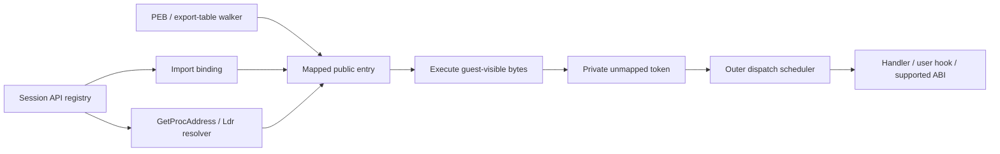

# Unified Windows API addresses

Speakeasy gives each API function of a synthetic module one fixed address in that module. The guest can read and execute the code at this address. The export table, the bound imports, `GetProcAddress`, `LdrGetProcedureAddress` and the kernel routine lookup all get the address from one API registry (`ApiRegistry` in `speakeasy/windows/api_registry.py`). If you add a handler or a user hook, the emulator runs different code for the call, but the address does not change.

So you can use the address of an API as a debugger breakpoint and as a symbol address. The guest can read or patch the code at the address, and this code runs before the Python handler. The memory access counts (`memory.accesses`) only count accesses. It does not change which calls go to Python.

A forwarder string leads to the entry in the destination module, as in a PE. A dynamic entry is an entry that the emulator adds at run time, when the guest asks for a function that the export table does not have. The registry and `GetProcAddress` find dynamic entries, but the export table does not get them.

## Modules and export tables

`ApiModuleLoader` takes the names and ordinals of a module from its export manifest or from its ordinal names, if the module has one of them. Otherwise it uses the declarations of the DLL in the signature database and the function and data handlers of the DLL. The export table also has the declarations that the emulator cannot call from the signature, and each of them has an entry where you can set a breakpoint. The loader leaves out the declarations for the other architecture. It does not add `A` or `W` variants.

A placeholder for an unknown module is a mapped PE with valid headers and a `.dyn` section, but no exports.

Each file `speakeasy/resources/win32/exports/<arch>/<module>.json` records the export directory of one real Windows binary: the directory name, the ordinals, the names, the forwarder strings and the code or data kind. `speakeasy/resources/win32/exports/README.md` tells where the binaries come from and gives the format. The manifest names and ordinals define the EAT, with the ordinal-only entries, so an import by ordinal gets the same function as on the Windows build of the manifest. A handler name that is not in the manifest gets an ordinal after the highest manifest ordinal.

A module without a manifest can have a file `speakeasy/resources/win32/ordinals/<arch>/<module>.json` that gives the name of each ordinal. On x86, `mfc42` and `mfc42u` have such a file. The loader uses these names and ordinals as it uses a manifest, so an import by ordinal shows its name in the report, for example `mfc42.?AfxGetModuleState@@YGPAVAFX_MODULE_STATE@@XZ`. `speakeasy/resources/win32/ordinals/README.md` tells where the names come from.

Kernel modules and the user modules without a manifest or ordinal names use the signature database. win32metadata records the declarations of the import libraries, so it does not have the undocumented exports. phnt does not give ordinals or forwarders. For these modules, the emulator gives the ordinals in a fixed order, unless a handler gives an explicit ordinal.

The exports of a real PE run its own code, also when a handler with the same name exists. A DLL from the module directory of the config is a real PE, so the emulator runs its code and not the handlers. The emulator does not add dynamic entries to a real PE. To load a real PE at a different base, the PE must have relocation data.

## Public entries and private dispatch

Each function of a synthetic module has a 32-byte slot. The first 16 bytes are NOPs, so that a patch has space, and the public entry starts at offset 16. When the entry code gets to its jump, the stack, the registers and the flags are the same as at the entry:

| Architecture | Public bytes |
| --- | --- |
| x86 | `8B FF 55 8B EC` (`mov edi,edi; push ebp; mov ebp,esp`), `5D` (`pop ebp`), then `E9 rel32` |
| x64 | `66 90`, followed by `FF 25 00 00 00 00` and an embedded 64-bit target |

The jump goes to a token, which is a unique address that the emulator never maps. When the guest fetches a token, the emulator stops Unicorn and the run loop continues. Then the Python handler runs outside the Unicorn callback. The first five x86 bytes are the hot-patch prologue of Windows. An inline hook that knows this prologue copies it to a trampoline and continues at `pop ebp`, which restores the stack and EBP before the jump.

If a patch makes the public entry return or jump to a different address, the guest runs the patched code, and the handler can be skipped.

## Dynamic entries

Each synthetic image has a `.dyn` section of 64 KiB, with space for 2,048 dynamic entries. When the guest asks for the same function again, it gets the same address. A new dynamic entry does not change the EAT of the module, its `SizeOfImage`, its section layout or the existing addresses.

A placeholder for an unknown module can give dynamic entries. For a module with known exports, a lookup of a name that the module does not export fails, except when the signature database declares the name for that DLL, `apis.stubs` is set or a user hook exists for the name. A failed `GetProcAddress` sets `ERROR_PROC_NOT_FOUND`. The import binding of the loader and the `get_proc` interface can make dynamic entries for missing exports of a synthetic module. So the import gets an address, and a call to it later gives an unsupported API error that names the function.

`apis.stubs` lets the emulator make dynamic entries. It also lets the emulator call a function that has no declaration: the emulator calls it as a stdcall function with 4 arguments, logs these arguments and returns 1. This is a guess, so that execution can continue. On x86 it corrupts the stack when the real argument count is different. A function that has a declaration that the emulator cannot call does not get this guess. A call to it, or to another unsupported function, logs an error and stops the run. Under GDB, the debugger stops before the emulator records the call, and the emulator holds the call. You can then examine it, add a hook, change PC or patch the entry.

## Signature and handler dispatch

To call a function without a handler, the emulator uses the declaration for the same module, name and architecture. If more than one database declares it, the emulator uses the database with the highest priority. To show the arguments of a handler call, the emulator can also use the declaration of the name in a different DLL, but it never uses that declaration to call a function without a handler.

When more than one export name has the same address, the emulator uses the name that it registered first for the call and for the report, because the address does not tell which name the caller used. Hooks match that name.

The emulator can call a declaration without a handler when all arguments are integers or pointers and the convention is cdecl or stdcall, or the Win64 convention on x64. The emulator cannot call skipped declarations, variadic functions, other conventions, floating-point arguments, struct return values or 64-bit return values on x86. These functions are still in the export table, and you can add handlers or hooks for them.

If a handler changes PC, SP, the return address or the current run, the emulator does not return from the call again. A handler that changes the stack does its own return.

## Debugger limits and symbols

A resume or a step is one action, also when the run passes through API calls. When you step over the last jump of a trampoline, the intercepted call or the guest jump completes, and no instruction of the caller runs. A pending watchpoint or interrupt stops the debugger before the handler runs. A memory watchpoint stops after the instruction completes, so a resume does not do the guest write again.

`Speakeasy.get_symbols()` returns a `{address: (dll, name)}` snapshot with the registry exports, the dynamic entries and the other kernel symbols. If two symbols have the same address, the registry entry wins. `get_symbol_from_address(address)` finds public entries, addresses inside a trampoline and exact kernel symbols. `Speakeasy.get_api_symbols()` returns a snapshot of the function and data labels, with the dynamic entries and the internal callback entries. It does not include the tokens or the EAT forwarder strings. Take a new snapshot after the emulator resolves more modules or functions. The PE exports do not have the dynamic entries.

Under the debugger, a memory fault stops the debugger, and the run ends when you resume. A change of the registers or PC at this stop does not let the run continue.

## Fidelity limits

All synthetic entries have the same code, except for the token. The emulator does not make `Nt` and `Zw` names aliases at the same address, and it does not model real system call numbers or the layout of ntdll. FreshyCalls, Halo's Gate and other methods that read the layout of ntdll need real native files or explicit handlers.

The guest cannot use the token range for code or data. A read or write in it faults, and the guest SEH can take the fault. If DllMain returns FALSE and the run has no other error, the error type of the run is `dll_initialization_failed`. The other dependencies and the main sample continue.
