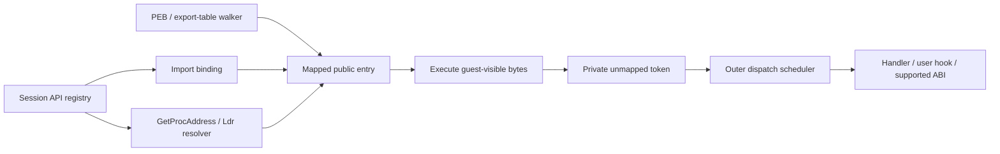

# Unified Windows API addresses

Speakeasy gives each API function of a synthetic module one fixed address in that module. The guest can read and execute the code at this address. The export table, the bound imports, `GetProcAddress`, `LdrGetProcedureAddress` and the kernel routine lookup all get the address from one API registry (`ApiRegistry` in `speakeasy/windows/api_registry.py`). If you add a handler or a user hook, the emulator runs different code for the call, but the address does not change.

So you can use the address of an API as a debugger breakpoint and as a symbol address. The guest can read or patch the code at the address, and this code runs before the Python handler. Memory tracing only counts accesses. It does not change which calls go to Python.

A forwarder string leads to the entry in the destination module, as in a PE. A dynamic entry is an entry that the emulator adds at run time, when the guest asks for a function that the export table does not have. The registry and `GetProcAddress` find dynamic entries, but the export table does not get them.

## Modules and export tables

`ApiModuleLoader` takes the names and ordinals of a module from its export manifest or from its ordinal names, if the module has one of them. Otherwise it uses the declarations of the DLL in the signature database and the function and data handlers of the DLL. The export table also has the declarations that the emulator cannot call from the signature, and each of them has an entry where you can set a breakpoint. The loader leaves out the declarations for the other architecture. It does not add `A` or `W` variants.

The generated PE has a read-only header and export directory, executable `.text` and `.dyn` sections and a writable `.data` section. The name pointers are sorted, the name ordinals point to the correct EAT entries, and explicit ordinals keep the gaps between them. Code exports and data exports are different kinds. A placeholder for an unknown module is a mapped PE with valid headers and a `.dyn` section, but no exports.

Each file `speakeasy/resources/win32/exports/<arch>/<module>.json` records the export directory of one real Windows binary: the directory name, the ordinals, the names, the forwarder strings and the code or data kind. It also records the file version and the SHA-256 of the binary. `speakeasy/resources/win32/exports/README.md` tells where the binaries come from and gives the format. When a module has a manifest, the generated export directory gets its name from the manifest, for example `KERNEL32.dll`. The manifest names and ordinals define the EAT, with the ordinal-only entries, so an import by ordinal gets the same function as on the Windows build of the manifest. A handler name that is not in the manifest gets an ordinal after the highest manifest ordinal. If the manifest has the `A` or `W` variant of a handler name, the emulator does not export the handler name, because it uses that name only to find the handler. A data export of the manifest gets 0x100 bytes of writable memory set to zero, unless a data handler sets the value. The emulator records the manifest forwarders but does not follow them: a forwarded name gets an entry in the module itself.

A module without a manifest can have a file `speakeasy/resources/win32/ordinals/<arch>/<module>.json` that gives the name of each ordinal. On x86, `mfc42` and `mfc42u` have such a file. The loader uses these names and ordinals as it uses a manifest. The file does not tell code from data, so the loader uses the MSVC decoration of each name: a static data member (`?name@scope@@0`, `1` or `2`) or a global variable (`?name@@3`) is a data export, and all other names are functions. So an import by ordinal shows its name in the report, for example `mfc42.?AfxGetModuleState@@YGPAVAFX_MODULE_STATE@@XZ`. `speakeasy/resources/win32/ordinals/README.md` tells where the names come from.

Kernel modules and the user modules without a manifest or ordinal names use the signature database. win32metadata records the declarations of the import libraries, so it does not have the undocumented exports. phnt does not give ordinals or forwarders. For these modules, the emulator gives the ordinals in a fixed order, unless a handler gives an explicit ordinal. The CRT variables `_fmode`, `_commode`, `__initenv`, `_iob` and `_sys_nerr` are writable data exports. Their accessor functions, such as `__iob_func` and `__acrt_iob_func`, return the same memory. The phnt generator does not read the architecture guards of the headers. `FUNCTION_ARCHITECTURES` in `scripts/gen_phnt_signatures.py` lists the functions that only one architecture has, and the other phnt declarations are for both architectures.

`PeLoader` keeps the export RVAs, ordinals, data exports, aliases and forwarder strings of a real PE. The exports of a real PE run its own code, also when a handler with the same name exists. A DLL from the module directory of the config is a real PE, so the emulator runs its code and not the handlers. The emulator does not add dynamic entries to a real PE. To load a real PE at a different base, the PE must have relocation data. The loader rejects a PE for the wrong architecture before it maps it.

## Public entries and private dispatch

Each function of a synthetic module has a 32-byte slot. The first 16 bytes are NOPs, so that a patch has space, and the public entry starts at offset 16. When the entry code gets to its jump, the stack, the registers and the flags are the same as at the entry:

| Architecture | Public bytes |
| --- | --- |
| x86 | `8B FF 55 8B EC` (`mov edi,edi; push ebp; mov ebp,esp`), `5D` (`pop ebp`), then `E9 rel32` |
| x64 | `66 90`, followed by `FF 25 00 00 00 00` and an embedded 64-bit target |

The jump goes to a token, which is a unique address that the emulator never maps. The tokens are in a reserved range of 1 MiB, 16 bytes apart. This range is not the range of the SEH and the other return addresses of the emulator. The emulator never uses a token again, also after a failed load, so a token cannot change to a different API.

The emulator checks for API tokens before it calls the user hooks for invalid memory. When the guest fetches a token, the emulator stops Unicorn and the run loop continues. Then the Python handler runs outside the Unicorn callback. So the emulator does not map pages for the API code, and the order of breakpoints, steps, interrupts and loader notifications is clear. If the guest jumps to an address in the range that is not a token, or reads or writes the range, the emulator stops Unicorn and gives an access violation to the guest SEH, outside the callback. If no handler takes it, the run ends with `invalid_read`, `invalid_write` or `invalid_fetch`. A guest handler can change PC or registers, but the emulator never maps the range. The first five x86 bytes are the hot-patch prologue of Windows. An inline hook that knows this prologue copies it to a trampoline and continues at `pop ebp`, which restores the stack and EBP before the jump.

When the host or a debugger patches guest code, Unicorn discards its translated code. If a patch makes the public entry return or jump to a different address, the guest runs the patched code, and the handler can be skipped. A suspended call keeps its entry bytes, SP and return slot. If you change its frame or the entry code, the emulator drops the suspended call and runs the changed entry code.

A real forwarder resolves through the destination module and the name or ordinal. The emulator checks for loops and for chains that are too long. It does not make an entry for a destination that does not exist. When a synthetic module has a forwarder of a real DLL, the EAT keeps the forwarder string, and the emulator does not write code over it. A forwarder can lead to guest code or to shared data.

## Dynamic entries

Each synthetic image has a `.dyn` section of 64 KiB, with space for 2,048 dynamic entries. In kernel32, the return `jmp` of the entry point and the thread start routines uses one of these slots (see [Architecture](architecture.md)). A name and an ordinal give different entries. When the guest asks for the same function again, it gets the same address. A new dynamic entry does not change the EAT of the module, its `SizeOfImage`, its section layout or the existing addresses.

A placeholder for an unknown module can give dynamic entries. For a module with known exports, a lookup of a name that the module does not export fails, except when the signature database declares the name for that DLL, `functions_always_exist` is set or a user hook exists for the name. So a declared name resolves also when the manifest does not have it, because other Windows builds export it. A failed `GetProcAddress` sets `ERROR_PROC_NOT_FOUND`. The import binding of the loader and the `get_proc` interface can make dynamic entries for missing exports of a synthetic module. So the import gets an address, and a call to it later gives an unsupported API error that names the function. The emulator never adds entries to a real PE. If the `.dyn` section is full, or the guest changed its bytes or protection, the lookup fails, and the existing entries do not move.

`functions_always_exist` lets the emulator make dynamic entries. It also lets the emulator call a function that has no declaration: the emulator calls it as a stdcall function with 4 arguments, logs these arguments and returns 1. This is a guess, so that execution can continue. On x86 it corrupts the stack when the real argument count is different. A function that has a declaration that the emulator cannot call does not get this guess. A call to it, or to another unsupported function, logs an error and stops the run. Under GDB, the debugger stops before the emulator records the call, and the emulator holds the call. You can then examine it, add a hook, change PC or patch the entry.

## Signature and handler dispatch

To call a function without a handler, the emulator uses the declaration for the same module, name and architecture. If more than one database declares it, the emulator uses the database with the highest priority. To show the arguments of a handler call, the emulator can also use the declaration of the name in a different DLL, but it never uses that declaration to call a function without a handler.

When more than one export name has the same address, the emulator uses the name that it registered first for the call and for the report, because the address does not tell which name the caller used. Hooks match that name.

The emulator can call a declaration without a handler when all arguments are integers or pointers and the convention is cdecl or stdcall, or the Win64 convention on x64. An argument that is a struct passed by value uses its stack slots on x86 and one slot on x64. The emulator cannot call skipped declarations, variadic functions, other conventions, floating-point arguments, struct return values or 64-bit return values on x86. These functions are still in the export table, and you can add handlers or hooks for them. If a signature database raises an exception during the lookup, the emulator reports the DLL and function of the call, and does not use the declaration of a different database. If a bundled database file cannot be read or is not valid, the emulator skips it.

The emulator records each API event on the run that made the call. If a handler changes PC, SP, the return address or the current run, the emulator does not return from the call again. A handler that changes the stack does its own return. If a handler changes SP but leaves PC on the token, and it does not start a callback or another run, the run ends with `api_handler_did_not_return`. The emulator does not call the handler again. A callback frame keeps the return slot, the stack, the calling convention and the result of the API, also across nested guest callbacks and callbacks in the queue. If a DLL initializer fails later, the API event shows the final result.

## Loader and process integration

An image uses one continuous range of memory. Before the loader adds the module to the module list, it checks the regions and writes them in that range, registers the exports, binds the imports and sets the section permissions. If a module or one of its dependencies fails to load, the loader removes the new mappings, registry records, import bindings and PEB entries. It keeps the addresses and entries that were there before. The emulator sends the module change notifications after the complete load. If a listener raises an exception, the emulator logs it, keeps the load and calls the other listeners.

By default, `PeLoader` does not reject a PE for errors in the import and export data. It logs a warning and leaves out a malformed delay import directory, an export entry that is not valid or a malformed forwarder. It decodes DLL names that are not ASCII as Latin-1, so that no byte is lost. The guest can still read the header bytes. The loader always checks that the image fits its range, that the architecture is correct and that the image has relocation data if it must move. It rejects a section that goes past `SizeOfImage`, a machine type that does not agree with the optional header, and a move without relocations.

When pefile drops a malformed function name, the other static imports keep their thunk and IAT positions. The skipped slots do not change, and each valid entry after them binds to its own slot. If OriginalFirstThunk is empty or cannot be read, the loader uses the IAT, as pefile does. The loader rejects ordinals with reserved bits set. It limits the number of import slots that it reads for each image, but it can always read the terminating NUL. A synthetic module for a name that is not ASCII keeps its real name, path and registry key. It uses an ASCII name only in its generated export directory.

Normal imports and delay imports use the same import list and binder. The loader binds the delay imports of a real PE at load time. It also rebases old delay import descriptors that hold virtual addresses. When the guest maps a PE itself, the emulator checks the architecture, and it reads the descriptors, thunks and strings only inside the mapped image. It checks all import slots before it writes any of them, and it does not change a slot that is not valid. The loader keeps the import bindings apart from the API registry, which owns the addresses.

Each process has its own loader entries. The list heads are real sentinel entries with forward and back links to each other, also when a list is empty. The main image is first in the load order and the memory order, and it is not in the initialization order. The emulator adds the core and default DLLs when it allocates the PEB, and keeps the modules of each process when it initializes the PEB again. A module that is already loaded goes only into the PEB of the selected process. Kernel modules and hidden modules are not in the PEB of a user process. When the emulator allocates another PEB, the PEB pointer in FS or GS of the running thread does not change.

The run loop initializes the dependencies of a real DLL in the order in which they completed the load, with the TLS callbacks before DllMain. It initializes only the modules of the current process, and it keeps the initialization state for each process. `LoadLibrary` runs the initializers as guest callbacks. A nested load sees the initialization state and does not queue the same module two times. When DllMain fails during `LoadLibrary`, the emulator removes the new PEB entries and the new mappings that no other process uses. It keeps a module that another process has. `LdrLoadDll` also clears its output handle and returns `STATUS_DLL_INIT_FAILED`. Synthetic API modules have no initializer.

All processes share one emulated address space. Each process has its own PEB module list, but the address spaces are not separate, and processes can share module data. The emulator does not model the full Windows reference counting, the API set schema of each Windows build, the native TLS behavior, the special mapping modes of `LoadLibraryEx` or the notifications when a DLL unloads.

## Debugger limits and symbols

A resume or a step is one action, also when the run passes through API calls. When you step over the last jump of a trampoline, the intercepted call or the guest jump completes, and no instruction of the caller runs. A pending watchpoint or interrupt stops the debugger before the handler runs. A memory watchpoint stops after the instruction completes, so a resume does not do the guest write again.

The instruction limit is for each run, and it continues across debugger actions and API calls. Guest instructions count, and Python code does not. The active time of a run includes the Python handlers, also across debugger actions and API calls, but not the time while the debugger is paused. Each entry point in the queue, each new shellcode run and each call of `Speakeasy.call()` starts with a new time limit. `max_total_time` limits the active time of all runs in the queue and all nested runs in one call of `run_module`, `run_shellcode` or `call`. 0 disables it. A direct call of the emulator `start()` or `run_module()` uses the same scope. Each new public call starts a new total time, and the time while the debugger is paused does not count. When the total time runs out, the emulator stops the runs in the queue with the error `max_total_time`. Unicorn stops at the earlier of the two limits. The emulator measures the time of a Python handler after it returns, so a host hook that blocks can go past the limit. The initial load and setup do not count, but loads and run loop work during execution count. With `emulate_children`, the load of each child process counts. When the total time runs out, the emulator does not load or run the child processes that are left, and it adds a `max_total_time` error with the number of these processes to the top-level `errors` of the report. `max_runs` limits the length of the queue, and the total time limits the runs that follow each other. When a run has no time or instructions left, the emulator stops it with the limit error. It does not start Unicorn with a limit of zero, because Unicorn reads zero as no limit. If a run or a callback returns at the instruction where a limit is reached, the emulator completes the return. The emulator checks for cancellation before each start of Unicorn. When `max_instructions` is set, the emulator counts each instruction in Python across API calls, and it also gives the remaining count to Unicorn for each start. This makes the run slower. Unicorn has no interface that gives the number of instructions that it ran, and a count of blocks is wrong for REP iterations and partial blocks. [Unicorn 2.1.4 keeps and resets that counter inside](https://github.com/unicorn-engine/unicorn/blob/2.1.4/uc.c#L987-L1024).

`Speakeasy.get_symbols()` returns a `{address: (dll, name)}` snapshot with the registry exports, the dynamic entries and the other kernel symbols. If two symbols have the same address, the registry entry wins. `get_symbol_from_address(address)` finds public entries, addresses inside a trampoline and exact kernel symbols. `Speakeasy.get_api_symbols()` returns a snapshot of the function and data labels, with the dynamic entries and the internal callback entries. It does not include the tokens or the EAT forwarder strings. Take a new snapshot after the emulator resolves more modules or functions. The PE exports do not have the dynamic entries.

Under the debugger, a memory fault stops the debugger, and the run ends when you resume. A change of the registers or PC at this stop does not let the run continue. Without a debugger, when the guest runs code in memory without execute permission, the emulator continues. This occurs for allocated memory and for the pages of a real PE, for example when a packer runs decrypted bytes in `.data`. This is not a full model of the Windows DEP rules, and it does not depend on the architecture or NXCOMPAT. For a page of a real PE, the emulator adds execute permission to the page after Unicorn stops, and keeps the read and write permissions. So the same fetch does not fault again, and the permission change occurs outside the Unicorn callback. A debugger stop at a fault and the permissions of the synthetic API sections always apply. The emulator waits for Unicorn to stop before it completes a fault, so it does not give the error to the next run in the queue. The stop at an unsupported API under GDB, described above, is a different path.

The limit on repeated SEH faults applies across handler returns. When a handler or filter runs, the emulator does not count this as progress. The count starts again when guest execution moves forward after the resume, when a different fault occurs or when a new run starts. If the same fault occurs again without a repair, the run ends with its normal memory error, and the handlers do not run again and again until the time limit. This limits the repeats. It does not give full C++ exception behavior or a model of the lifetime of recovery pages. Progress at the same PC, for example in a REP instruction, does not count. When no handler and no unhandled exception filter takes the exception of a `RaiseException` call, the call returns to its caller if the exception is continuable. A non-continuable exception ends the run with `unhandled_exception`, because on Windows the caller cannot continue after it. See [Exception dispatch](exceptions.md).

## Fidelity limits

All synthetic entries have the same code, except for the token. The emulator does not make `Nt` and `Zw` names aliases at the same address, and it does not model real system call numbers or the layout of ntdll. FreshyCalls, Halo's Gate and other methods that read the layout of ntdll need real native files or explicit handlers. The ordinal base of a PE export directory is a DWORD, and the image builder supports that range. `GetProcAddress` and the forwarder syntax for ordinals use the 16-bit ordinals of Windows. The generated ordinals in the bundled databases fit in that range.

The guest cannot use the token range for code or data. A read or write in it faults, and the guest SEH can take the fault. When a DLL initializer fails at start, the emulator logs a warning, keeps the exports of the DLL mapped and sets the module state to `init_error` (`LoadState.INIT_ERROR`). If DllMain returns FALSE and the run has no other error, the error type of the run is `dll_initialization_failed`. The other dependencies and the main sample continue. The emulator does not mark the module as initialized and does not try the initializer again at start. When a load fails at run time, the API returns its failure value, and the emulator removes the new PEB entries.
